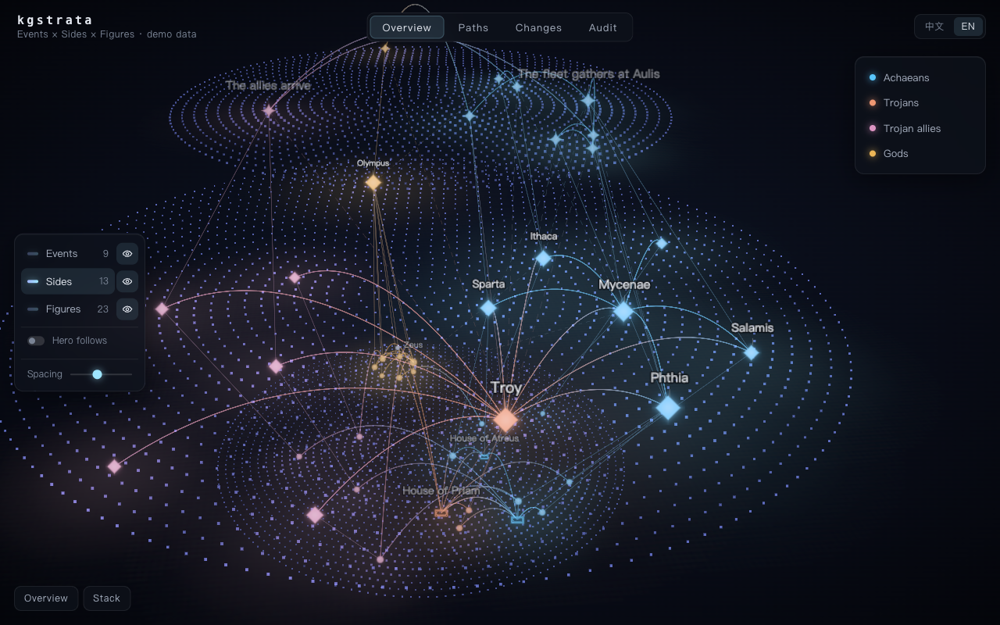

# kgstrata

[简体中文](README.zh-CN.md) · **[Live demo](https://iiwish.github.io/kgstrata/?lang=en)**

**kgstrata draws layered knowledge graphs in 3D with three.js: an ontology graph above a physical graph (tables and fields), with the mappings between them running vertically.**

Each layer is a graph with its own relations, and the layers are linked by a many-to-many mapping (which tables each concept lands on). A flat drawing has to mix three kinds of lines in one plane. kgstrata gives each graph its own plane, keeps in-layer relations inside it, and runs the mappings through the third dimension. Tables are placed below the concepts they map to, so mappings that line up do not cross, and the ones that do not line up stand out. More layers (metrics above, dashboards below) work the same way.

[](https://iiwish.github.io/kgstrata/?lang=en)

> **Status: early (0.x).** The API may still change between minor versions; see [CHANGELOG.md](CHANGELOG.md).

## Features

- **Aligned layers.** Correspondence blocks (one-to-one, one-to-many, many-to-one, many-to-many) are aligned vertically. The layout is deterministic.
- **Hero and supporting layers.** One layer fills the view; the others shrink and dim. Switch the hero, follow the selection, or blend continuously with per-layer weights.
- **Hidden layers with bridges.** Hide a middle layer and the layers it separated get dashed lines through it: metrics connect straight to the tables they land on.
- **Containment.** Nodes contain children (tables contain fields). Children are folded by default and their relations roll up to the parent with summed weights; double-click to expand.
- **Path replay** (plugin). A question walks through the ontology and down into the tables, step by step.
- **Version comparison** (plugin). Semantic diff of two versions with [kgdiff](https://github.com/iiwish/kgdiff): added, removed, renamed, merged, re-mapped. Replayable.
- **Mapping audit** (plugin). Which ontology relations cannot be walked through foreign keys, which foreign keys the ontology does not account for, which nodes have no mapping: gaps marked on the map and listed in a panel.
- **React components.** `<StrataCanvas>`, hooks and panels (layer list, hero slider, path list, diff panel, audit panel).
- **Per-instance language and theme.** English and Simplified Chinese; every theme colour can be overridden.
- **Headless entry.** Validation, layout and bridge computation without three.js, for Node or Workers.
- **View state by id.** `strata.view` / `setView()` round-trip through JSON, URLs included.

## Install

```sh
npm install kgstrata three
```

`three` is a peer dependency (`>=0.154.0 <0.200.0`; 0.154 to 0.187 have been run). That is enough for the core, path replay, headless and React entries; none of them loads WebAssembly. A minimal page built with Vite is about 686 kB of JavaScript including three.js (about 180 kB gzipped).

## Quick start

The host element needs a size; the canvas fills it.

```ts
import { Strata, type StrataData } from 'kgstrata'

const data: StrataData = {
  version: 2,
  layers: [
    { id: 'onto', name: 'Ontology' },
    { id: 'table', name: 'Tables' },
  ],
  nodes: [
    { id: 'onto:company', layer: 'onto', label: 'Company' },
    { id: 'onto:person', layer: 'onto', label: 'Person' },
    { id: 'tbl:company', layer: 'table', label: 'company', type: 'table' },
    { id: 'tbl:person', layer: 'table', label: 'person', type: 'table' },
  ],
  relations: [
    { source: 'onto:person', target: 'onto:company', type: 'works-for' },
    { source: 'tbl:person', target: 'tbl:company', type: 'fk' },
    { source: 'onto:company', target: 'tbl:company', type: 'maps-to' },
    { source: 'onto:person', target: 'tbl:person', type: 'maps-to' },
  ],
}

const strata = new Strata(document.getElementById('graph')!, { hero: 'onto' })
const issues = strata.setData(data) // problems found in the data; [] when clean
// later: strata.dispose()
```

With React (`npm install react react-dom` as well):

```tsx
import { LayerList, StrataCanvas } from 'kgstrata/react'
import 'kgstrata/react/styles.css'

export function Graph() {
  return (
    <StrataCanvas data={data} options={{ hero: 'onto' }} style={{ height: 600 }}>
      <aside className="kgs-panel" style={{ position: 'absolute', left: 16, top: 16, width: 200, padding: 8 }}>
        <LayerList />
      </aside>
    </StrataCanvas>
  )
}
```

## Add what you need

**Path replay** (`kgstrata/path`, nothing extra to install):

```ts
import { pathPlugin } from 'kgstrata/path'

const path = strata.use(pathPlugin())
path.play(['onto:person', 'onto:company', 'tbl:company'])
path.on('step', ({ ids, reached }) => console.log(`${reached}/${ids.length}`))
```

**Version comparison** (`kgstrata/diff`, also `npm install @kgdiff/core @kgdiff/scene @kgdiff/compute`; adds three WebAssembly files, about 1.9 MB):

```ts
import { diffPlugin } from 'kgstrata/diff'

const diff = strata.use(diffPlugin())
const result = await diff.show(before, after) // null if superseded
diff.play(true)
diff.exit()
```

Vite 8, webpack 5 and Next.js 16 need no configuration. Vite 6 (dev server), Rollup, esbuild and Parcel 2 need a few lines each; see [Bundlers](docs/getting-started.md#bundlers).

**Mapping audit** (`kgstrata/audit`, nothing extra to install): which ontology relations cannot be walked through foreign keys, which foreign keys nothing accounts for, which nodes have no mapping, drawn on the map.

```ts
import { auditPlugin } from 'kgstrata/audit'

const audit = strata.use(auditPlugin())
const result = audit.show() // also as plain JSON: auditMappings in kgstrata/headless
audit.select({ kind: 'relation', id: result!.relations[0].id })
```

**Headless** (`kgstrata/headless`, no three.js needed at runtime):

```ts
import { validate, resolve, layoutStrata } from 'kgstrata/headless'

const issues = validate(data)
const layout = layoutStrata(resolve(data).resolved) // positions, blocks, mapping classes
```

## Data contract at a glance

Four flat lists: `layers` (top to bottom), `nodes`, `relations`, optional `groupings`.

- A relation between two nodes of the same layer stays in that layer; between layers it is a mapping. There is one relation type.
- `parent` means "contained in" (a field in a table). Relations on folded children roll up to the parent, weights summed.
- `weight` and `primary` on mappings decide which mapping aligns a block.
- `type` says what a node is; the `nodeStyles` option decides its shape.
- `setData` and `validate` return issues with stable codes (`duplicate-node`, `dangling-relation`, …) instead of throwing.

Full reference: [docs/data.md](docs/data.md).

## Documentation

| Page | Contents |
|---|---|
| [Getting started](docs/getting-started.md) | Install, minimal page, sizing, cleanup, common problems |
| [Data contract](docs/data.md) | Layers, nodes, relations, groupings, containment, all validation codes |
| [API](docs/api.md) | `Strata` members, options, view state, events, camera shots |
| [Plugins](docs/plugins.md) | Path replay, version comparison, mapping audit, writing your own plugin |
| [React](docs/react.md) | `<StrataCanvas>`, hooks, panels, CSS variables, SSR |
| [Theming and languages](docs/theming-and-i18n.md) | `locale`, `setLocale`, registering a language, `setTheme`, every theme field |
| [Headless](docs/headless.md) | Validation, layout, mapping audit and bridges without rendering |
| [Design](docs/design.md) | The rules behind alignment, composition and visuals |
| [Examples](examples) | Runnable vanilla, React, diff and custom-plugin examples |

## Entry points

| Import | Contents | Needs |
|---|---|---|
| `kgstrata` | `Strata`, plugin contract, everything in `headless` | `three` |
| `kgstrata/path` | `pathPlugin()` | `three` |
| `kgstrata/diff` | `diffPlugin()`, kgdiff adapter | `three`, `@kgdiff/*` |
| `kgstrata/audit` | `auditPlugin()` | `three` |
| `kgstrata/headless` | validate, normalize, layout, mapping audit, proportions, bridges, types | — |
| `kgstrata/internals` | model, styler, renderer types for take-over plugins (**not covered by semver**) | `three` |
| `kgstrata/react` | `<StrataCanvas>`, hooks, panels | `three`, `react` |
| `kgstrata/react/path` | `<PathList>` | `three`, `react` |
| `kgstrata/react/diff` | `<DiffPanel>` | `three`, `react`, `@kgdiff/*` |
| `kgstrata/react/audit` | `<AuditPanel>` | `three`, `react` |
| `kgstrata/react/styles.css` | optional panel styles | — |

## Browser support and status

- Needs WebGL. Without it, `new Strata()` throws `StrataError` with `code: 'webgl-unavailable'` and `<StrataCanvas>` renders a fallback.
- Run with three.js 0.154 to 0.187 (0.153 fails in the shaders), React 18.3 and 19. Type declarations checked with `skipLibCheck: false` on TypeScript 5.2, 5.6 and 7.0 with `@types/three` 0.160, 0.170 and 0.187. Bundlers: see [Bundlers](docs/getting-started.md#bundlers).
- Safari and Firefox have not been tested.

Not done yet:

- Paths side by side: the ontology path above, the matching join path below.
- A light theme. Only the dark theme exists; all its colours can be overridden.
- Expanded fields are a first version: a small ring around the table that gets crowded, with overlapping labels, when a table has many fields.

## Contributing

The demo page is online at <https://iiwish.github.io/kgstrata/> (built from `main`). To run it locally, clone the repository and run `pnpm install && pnpm dev` (http://localhost:5207; `?layers=2`, `?layers=4`, `?stress=3000` change the data; the English demo is the Trojan War and the Chinese one is the Three Kingdoms, both with events, sides and figures from top to bottom: alliances and wars between sides are one graph, ties between figures are another, who fights for which side is the mapping, and families contain their members; the Changes tab compares Homer with the 2004 film *Troy* (and the official history with the novel *Romance of the Three Kingdoms*). `?data=troy` and `?data=threekingdoms` pick one, `?data=shop` switches to a made-up online store (an ontology and its tables, with metrics and dashboards on top), and `?lang=en` / `?lang=zh` switches between English and Chinese). See [CONTRIBUTING.md](CONTRIBUTING.md) for setup, module boundaries, adding a language and running the examples. Changes are listed in [CHANGELOG.md](CHANGELOG.md).

## License

[MIT](LICENSE)
