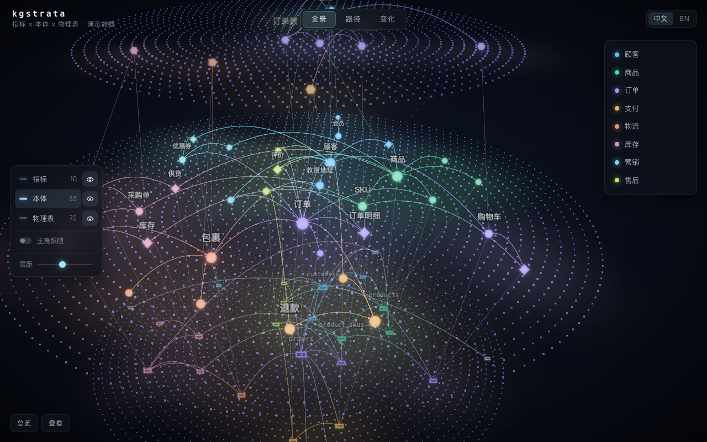

# kgstrata

[English](README.md)

**kgstrata 用 three.js 把多层知识图谱画成 3D：上面是本体图，下面是物理图（表和字段），层间的映射竖着走。**

每一层都是一张图，有自己的关系；层和层之间是多对多的映射（本体落在哪些表上）。画在一个平面上，三种线只能挤在一起。kgstrata 让每张图占一个平面，层内的关系留在平面里，映射走第三个方向。表摆在它所映射的本体下方：对得上的映射互不交叉，对不上的自己显出来。层可以更多（上面加指标，下面加看板），做法一样。



> **状态：早期版本（0.x）。** 小版本之间接口还可能变，见 [CHANGELOG.md](CHANGELOG.md)。

## 能做什么

- **层和层对齐。** 按对应块（一对一、一对多、多对一、多对多）上下对齐；布局是确定性的。
- **主角和配角。** 一层铺满画面，其余缩小、变暗。可以换主角、让主角跟着选中走，也可以按分量连续过渡。
- **隐藏层和穿透线。** 隐藏中间一层，被它隔开的两层之间画虚线：指标直接连到它最终落的表上。
- **包含关系。** 节点可以包含子节点（表包含字段）。子节点平时收起，它们的关系上卷到父节点、分量相加；双击展开。
- **路径回放**（插件）。一个问题先在本体上走，再落到表上，一步一步点亮。
- **两版对比**（插件）。用 [kgdiff](https://github.com/iiwish/kgdiff) 算两版之间的语义变化：新增、删除、改名、合并、映射调整，可以回放。
- **React 组件。** `<StrataCanvas>`、hooks 和面板（层列表、主次滑杆、路径列表、变化面板）。
- **语言和主题按实例配。** 英文和简体中文；主题的每个颜色都能改。
- **不带渲染的入口。** 校验、布局、穿透计算不需要 three.js，能在 Node、Worker 里跑。
- **视图状态都用 id。** `getView()` / `setView()` 可以存成 JSON、放进地址里。

## 安装

```sh
npm install kgstrata three
```

`three` 是 peer 依赖（`>=0.170.0 <0.200.0`，实测过 0.187）。核心、路径回放、headless、React 这几个入口只要这两个包，都不加载 WebAssembly。用 Vite 打一个最小页面，连 three.js 约 686 kB，gzip 后约 180 kB。

## 30 秒上手

宿主元素要有尺寸，画布会铺满它。

```ts
import { Strata, type StrataData } from 'kgstrata'

const data: StrataData = {
  version: 2,
  layers: [
    { id: 'onto', name: '本体' },
    { id: 'table', name: '物理表' },
  ],
  nodes: [
    { id: 'onto:company', layer: 'onto', label: '企业' },
    { id: 'onto:person', layer: 'onto', label: '自然人' },
    { id: 'tbl:company', layer: 'table', label: 'company', type: 'table' },
    { id: 'tbl:person', layer: 'table', label: 'person', type: 'table' },
  ],
  relations: [
    { source: 'onto:person', target: 'onto:company', type: '任职' },
    { source: 'tbl:person', target: 'tbl:company', type: 'fk' },
    { source: 'onto:company', target: 'tbl:company', type: '落地' },
    { source: 'onto:person', target: 'tbl:person', type: '落地' },
  ],
}

const strata = new Strata(document.getElementById('graph')!, { hero: 'onto', locale: 'zh-CN' })
const issues = strata.setData(data) // 数据里查出来的问题，没问题是 []
// 不用了：strata.dispose()
```

React（另装 `react`、`react-dom`）：

```tsx
import { LayerList, StrataCanvas } from 'kgstrata/react'
import 'kgstrata/react/styles.css'

export function Graph() {
  return (
    <div style={{ position: 'relative', height: 600 }}>
      <StrataCanvas data={data} options={{ hero: 'onto', locale: 'zh-CN' }} style={{ position: 'absolute', inset: 0 }}>
        <aside className="kgs-panel" style={{ position: 'absolute', left: 16, top: 16, width: 200, padding: 8 }}>
          <LayerList />
        </aside>
      </StrataCanvas>
    </div>
  )
}
```

## 按需加能力

**路径回放**（`kgstrata/path`，不用多装）：

```ts
import { pathPlugin } from 'kgstrata/path'

const path = strata.use(pathPlugin())
path.play(['onto:person', 'onto:company', 'tbl:company'])
path.on('step', ({ ids, reached }) => console.log(`${reached}/${ids.length}`))
```

**两版对比**（`kgstrata/diff`，另装 `@kgdiff/core @kgdiff/scene @kgdiff/layout`；会多出三个 WebAssembly 文件，共约 1.9 MB）：

```ts
import { diffPlugin } from 'kgstrata/diff'

const diff = strata.use(diffPlugin())
const result = await diff.show(before, after) // 被后来的请求顶掉时是 null
diff.play(true)
diff.exit()
```

Vite 8 不用配置。Vite 6 构建不用配置，开发服务器要在 `optimizeDeps.exclude` 里排除 kgdiff 的包；webpack、esbuild、Rollup 没有测过。详见 [getting-started.zh-CN.md](docs/getting-started.zh-CN.md#webassembly-和-kgstratadiff)。

**不带渲染**（`kgstrata/headless`，运行时不需要 three.js）：

```ts
import { validate, resolve, layoutStrata } from 'kgstrata/headless'

const issues = validate(data)
const layout = layoutStrata(resolve(data).resolved) // 位置、对应块、映射线的分类
```

## 数据契约速览

四个扁平的列表：`layers`（从上到下）、`nodes`、`relations`，以及可选的 `groupings`。

- 关系只有一种：两端在同一层就是层内的关系，在不同层就是映射。
- `parent` 表示“包含于”（字段在表里）。收起的子节点上的关系上卷到父节点，分量相加。
- 映射上的 `weight` 和 `primary` 决定哪条映射拿来对齐。
- `type` 说节点是什么；画成什么形状由 `nodeStyles` 选项定。
- `setData` 和 `validate` 不抛异常，返回带固定 code 的问题（`duplicate-node`、`dangling-relation`……）。

完整说明：[docs/data.zh-CN.md](docs/data.zh-CN.md)。

## 文档

| 文档 | 内容 |
|---|---|
| [上手](docs/getting-started.zh-CN.md) | 安装、最小页面、容器尺寸、销毁、常见问题 |
| [数据契约](docs/data.zh-CN.md) | 层、节点、关系、分组、包含、全部校验问题码 |
| [API](docs/api.zh-CN.md) | `Strata` 的成员、选项、视图状态、事件、镜头 |
| [插件](docs/plugins.zh-CN.md) | 路径回放、两版对比、自己写插件 |
| [React](docs/react.zh-CN.md) | `<StrataCanvas>`、hooks、面板、CSS 变量、SSR |
| [主题和语言](docs/theming-and-i18n.zh-CN.md) | `locale`、主题的每一项、怎么加一种语言 |
| [不带渲染](docs/headless.zh-CN.md) | 不渲染时的校验、布局、穿透计算 |
| [设计](docs/design.zh-CN.md) | 对齐、构图、视觉背后的规则 |
| [示例](examples) | 能直接跑的原生、React、两版对比、自定义插件示例 |

## 入口

| 引入 | 里面有什么 | 需要 |
|---|---|---|
| `kgstrata` | `Strata`、插件契约、`headless` 的全部 | `three` |
| `kgstrata/path` | `pathPlugin()` | `three` |
| `kgstrata/diff` | `diffPlugin()`、kgdiff 适配 | `three`、`@kgdiff/*` |
| `kgstrata/headless` | 校验、整理、布局、多层比例、穿透、类型 | — |
| `kgstrata/react` | `<StrataCanvas>`、hooks、面板 | `three`、`react` |
| `kgstrata/react/path` | `<PathList>` | `three`、`react` |
| `kgstrata/react/diff` | `<DiffPanel>` | `three`、`react`、`@kgdiff/*` |
| `kgstrata/react/styles.css` | 可选的面板样式 | — |

## 浏览器支持和现状

- 需要 WebGL。拿不到时 `new Strata()` 抛 `StrataError`（`code: 'webgl-unavailable'`），`<StrataCanvas>` 渲染 fallback。
- 实测过 three.js 0.187、React 19、Vite 8（变化入口另测过 Vite 6）。peer 范围内的其他版本应该能用，但没有测过。
- 还没有做过跨浏览器测试。

还没做的：

- 缺口审计：本体上哪些关系在物理层走不通，哪些外键在本体上没有对应的关系。
- 路径的上下对照：上面是本体路径，下面是对应的 join 路径。
- 浅色主题。现在只有夜景主题，但每个颜色都能改。
- 字段展开后的样子是第一版：围着表的一小圈，字段多时挤，名字互相挡。

## 参与

想看效果页：克隆仓库，`pnpm install && pnpm dev`（http://localhost:5207；`?layers=2`、`?layers=4`、`?stress=3000` 换数据；演示数据是一家虚构的网上商城，`?lang=zh` / `?lang=en` 切换中英文）。环境、模块边界、怎么加语言、怎么跑示例见 [CONTRIBUTING.md](CONTRIBUTING.md)。改动记在 [CHANGELOG.md](CHANGELOG.md)。

## 许可

[MIT](LICENSE)
